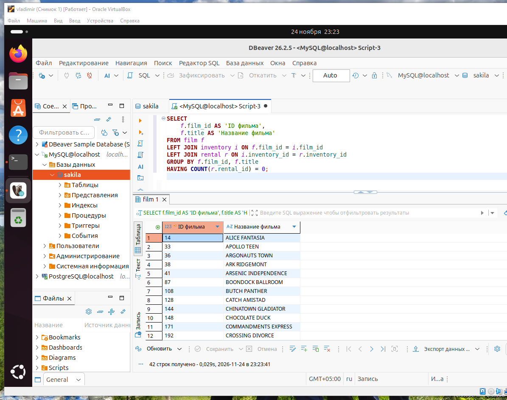

# Домашнее задание к занятию "`Расширенные возможности SQL`" - `Tsitovich Vladimir`


### Задание 1

Одним запросом получите информацию о магазине, в котором обслуживается более 300 покупателей, и выведите в результат следующую информацию:

-фамилия и имя сотрудника из этого магазина;
-город нахождения магазина;
-количество пользователей, закреплённых в этом магазине.

```

SELECT 
    st.last_name AS 'Фамилия сотрудника',
    st.first_name AS 'Имя сотрудника',
    ci.city AS 'Город',
    COUNT(cu.customer_id) AS 'Количество покупателей'
FROM store s
JOIN staff st ON s.store_id = st.store_id
JOIN address a ON s.address_id = a.address_id
JOIN city ci ON a.city_id = ci.city_id
JOIN customer cu ON s.store_id = cu.store_id
GROUP BY s.store_id, st.staff_id, ci.city
HAVING COUNT(cu.customer_id) > 300;

```


---

### Задание 2

Получите количество фильмов, продолжительность которых больше средней продолжительности всех фильмов.

```

SELECT COUNT(*) AS 'Количество фильмов'
FROM film
WHERE length > (
    SELECT AVG(length) 
    FROM film
);

```


---

### Задание 3

Получите информацию, за какой месяц была получена наибольшая сумма платежей, и добавьте информацию по количеству аренд за этот месяц.

```

SELECT 
    DATE_FORMAT(payment_date, '%Y-%m') AS 'Месяц',
    SUM(amount) AS 'Сумма платежей',
    COUNT(rental_id) AS 'Количество аренд'
FROM payment
GROUP BY DATE_FORMAT(payment_date, '%Y-%m')
ORDER BY SUM(amount) DESC
LIMIT 1;

```


### Задание 4

Посчитайте количество продаж, выполненных каждым продавцом. Добавьте вычисляемую колонку «Премия». Если количество продаж превышает 8000, то значение в колонке будет «Да», иначе должно быть значение «Нет».

```

SELECT 
    s.staff_id AS 'ID продавца',
    s.first_name AS 'Имя',
    s.last_name AS 'Фамилия',
    COUNT(p.payment_id) AS 'Количество продаж',
    CASE 
        WHEN COUNT(p.payment_id) > 8000 THEN 'Да'
        ELSE 'Нет'
    END AS 'Премия'
FROM staff s
LEFT JOIN payment p ON s.staff_id = p.staff_id
GROUP BY s.staff_id, s.first_name, s.last_name;

```


### Задание 5

Найдите фильмы, которые ни разу не брали в аренду.

```

SELECT 
    f.film_id AS 'ID фильма',
    f.title AS 'Название фильма'
FROM film f
LEFT JOIN inventory i ON f.film_id = i.film_id
LEFT JOIN rental r ON i.inventory_id = r.inventory_id
GROUP BY f.film_id, f.title
HAVING COUNT(r.rental_id) = 0;

```


 

